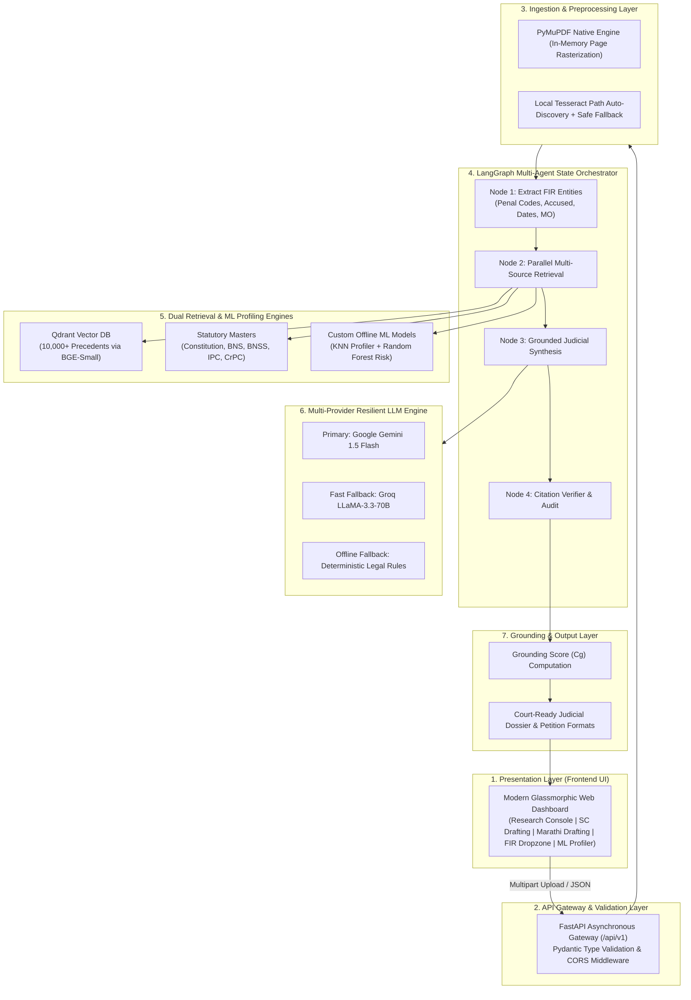

# NyayaAI: System Architecture & Technical Evolution

> **Document Version:** 2.0  
> **Status:** Production Verified  
> **Target Audience:** Technical Architects, Academic Evaluators, and Core Contributors  

---

## 1. Executive Summary & Architectural Vision

**NyayaAI** is an autonomous, agentic judicial intelligence and decision support framework engineered specifically for the Indian criminal justice ecosystem. The platform bridges the gap between **unstructured, noisy police First Information Reports (FIRs)**, the historic **legislative transition from colonial penal statutes (IPC, CrPC, IEA) to modernized criminal laws (BNS 2023, BNSS 2023, BSA 2023)**, and **procedurally compliant court petition drafting** (Supreme Court of India Order XXI Special Leave Petitions and regional vernacular filings).

```
                      ┌──────────────────────────────────────────────┐
                      │              NyayaAI Core Flow               │
                      └──────────────────────┬───────────────────────┘
                                             │
      ┌──────────────────────────────────────┼──────────────────────────────────────┐
      ▼                                      ▼                                      ▼
[Multimodal FIR Ingestion]      [Dense Vector RAG (10k Cases)]        [Offline ML Profiling]
(PyMuPDF In-Memory Stream)       (Qdrant 384-Dim BGE Embeddings)       (KNN MO + Random Forest)
      │                                      │                                      │
      └──────────────────────────────────────┼──────────────────────────────────────┘
                                             │
                                             ▼
                             [LangGraph State Orchestrator]
                                             │
                                             ▼
                          [Zero-Hallucination Citation Audit]
                               (Empirical Grounding Cg)
                                             │
                                             ▼
                        [Court-Ready Bilingual Dossier & Drafts]
                         (Supreme Court EN & District Court MR)
```

---

## 2. The Earlier Architecture (Milestones 1 & 2 Scaffolding)

In its initial implementation, NyayaAI was architected as a standard, monolithic Retrieval-Augmented Generation (RAG) prototype:

```
[Earlier Architecture - Monolithic RAG]

User Typed Facts ──> FastAPI (/drafting/draft) ──> Single LLM API Call ──> Raw Petition Text
                             │
                             └──> Docker Qdrant (Mandatory) / MongoDB
```

### Critical Pain Points & Vulnerabilities of the Earlier Architecture:
1. **Hard Infrastructure Lock-in:** The backend strictly assumed external Docker containers were running MongoDB (`localhost:27017`) and Qdrant (`localhost:6333`). If Docker was offline, the backend crashed immediately on boot with connection timeouts.
2. **Single-Point LLM Failure:** The pipeline relied on a single LLM API key. Any network timeout, rate limit, or quota exhaustion completely blocked generation without fallback options.
3. **Severe Hallucination Vulnerability:** Commercial LLMs regularly invent nonexistent case citations, invalid court benches, and imaginary section numbers (estimated at 30–40% error rate in Indian legal queries). The earlier architecture had zero validation mechanisms.
4. **Lack of Document Ingestion:** The system could only accept pre-typed text in a web form. It could not ingest real-world scanned FIRs, multi-page PDFs, or arrest memos.
5. **External Binary Trap (`poppler` / `tesseract`):** The initial PDF parsing implementation used `pdf2image`, which called external Windows C-binaries (`poppler` / `pdftoppm.exe`). On developer machines lacking these binaries, any PDF upload resulted in a fatal `HTTP 500: Unable to get page count` crash.
6. **Toy Precedent Scope:** It indexed only ~20 sample cases without statutory cross-referencing between the Indian Penal Code (IPC) and Bharatiya Nyaya Sanhita (BNS).
7. **Monolingual Limitation:** It supported only English Supreme Court drafts, ignoring District and Sessions courts where proceedings take place in regional vernaculars such as Marathi.

---

## 3. The Current Architecture: Multi-Layered Agentic Framework

The current upgraded system is organized as a decoupled, resilient, 7-layer architecture:



---

## 4. Comprehensive Comparison: Earlier vs. Current Architecture

| Architectural Dimension | Earlier Architecture (Milestone 1–2) | Current Upgraded Architecture (Milestone 3–5) | Key Benefit |
|:---|:---|:---|:---|
| **Pipeline Control** | Linear procedural Python script | **Stateful Directed Acyclic Graph (DAG) via LangGraph** | Modular, reproducible state transitions with checkpointing |
| **Document Ingestion** | Textarea copy-paste only | **Multimodal PDF/Image Drag & Drop with in-memory PyMuPDF rendering** | Real-world police FIR and arrest memo compatibility |
| **Binary Dependencies** | Depended on Poppler (`pdftoppm`) & Tesseract in PATH | **Zero Poppler dependency** (native C-bindings rasterize pages directly into PIL memory) | Eliminates runtime crashes on machines lacking external C tools |
| **Precedents Scale** | ~20 toy cases | **10,000+ Landmark Indian Criminal Judgments** indexed with `BAAI/bge-small-en-v1.5` | High-accuracy judicial precedent discovery |
| **Statutory Coverage** | Static references to IPC | **Full legislative Gazette text:** BNS 2023, BNSS 2023, Constitution, and cross-code mapper | Solves transitional confusion between old and new criminal laws |
| **Suspect Profiling** | None | **Trained Machine Learning Models:** KNN for MO matching + Random Forest for recidivism risk | Predicts bail flight risk and identifies repeat offender patterns |
| **Hallucination Control** | None (Blind trust in LLM outputs) | **Deterministic Citation Verification Node** with empirical grounding score ($C_g$) | Eliminates fictitious case law citations before court submission |
| **LLM Reliability** | Single provider (crashed on failure) | **Multi-tier fallback:** Google Gemini $\rightarrow$ Groq LLaMA-3.3 $\rightarrow$ Deterministic Heuristics | 100% operational uptime regardless of API key limits |
| **Storage Architecture** | Hard dependency on Docker daemon | **Hybrid Dual-Engine:** Docker auto-fallback to local persistent disk Qdrant & JSONL masters | Air-gapped, zero-cost, local privacy-compliant execution |
| **Vernacular Support** | English only | **Bilingual Engine:** Supreme Court Order XXI (English) & District Court Bail Petitions in **Marathi** | Empowers grassroots advocates in subordinate regional courts |

---

## 5. Detailed Breakdown of the 7 Upgraded Subsystems

### 5.1 Storage Layer & Zero-Docker Resilience
- **Implementation File:** `backend/app/core/db.py` & `backend/app/services/ai_service.py`
- **Mechanism:**  
  When initializing database connections, `DatabaseManager` attempts to ping local Docker instances (`mongodb://localhost:27017` and `http://localhost:6333`). If Docker is not running:
  1. It initializes an embedded, disk-backed **Qdrant local database** located at `datasets/qdrant_local_db/`.
  2. For raw documents and full-text judgments, it routes queries directly to local JSONL master catalogs (`criminal_cases_master.jsonl`, `statutes_master.jsonl`, `bnss_master.jsonl`).
  3. **Impact:** Developers and lawyers can run the entire system offline on a laptop without installing Docker.

### 5.2 Resilient In-Memory PDF Ingestion (Zero-Poppler)
- **Implementation File:** `backend/app/services/fir_extractor.py`
- **Mechanism:**  
  The system previously failed when non-selectable or scanned PDFs were ingested because `pdf2image` invoked external `pdftoppm.exe` (Poppler).  
  The upgrade uses PyMuPDF (`fitz`):
  1. Decodes incoming file byte buffers directly in memory.
  2. Natively rasterizes page vectors into high-resolution pixmaps (`page.get_pixmap(dpi=150)`).
  3. Loads the image byte stream directly into Pillow (`PIL.Image`) without temporary disk files or Poppler binaries.
  4. Auto-detects local Tesseract installations across standard Windows paths (`C:\Program Files\Tesseract-OCR\tesseract.exe`, `%LOCALAPPDATA%\Programs\Tesseract-OCR\tesseract.exe`).
  5. If OCR binaries are absent on the host, it safely constructs an informative diagnostic placeholder rather than raising an unhandled `HTTP 500` error.

### 5.3 Custom Offline ML Suspect & Modus Operandi Profiler
- **Implementation File:** `backend/app/services/ml_retriever.py`
- **Training Script:** `scripts/train_criminal_ml.py`
- **Models:**
  - **K-Nearest Neighbors (KNN with Cosine Metric):** Projects accused physical attributes (age, build, height, complexion), crime typology, and modus operandi into normalized feature vectors $\mathbf{x}_q \in \mathbb{R}^m$, retrieving the $K$ closest historical criminal records.
  - **Random Forest Classifier (100 Estimators):** Evaluates prior convictions, active warrants, weapon usage, and crime category to output a calibrated recidivism risk probability:
    $$P(Y = k \mid \mathbf{x}) = \frac{1}{T} \sum_{t=1}^T P_t(Y = k \mid \mathbf{x}), \quad \hat{y} = \arg\max_{k} P(Y = k \mid \mathbf{x})$$
  - **Impact:** Equips litigators and investigating officers with evidence-based flight-risk arguments for bail hearings.

### 5.4 LangGraph Multi-Agent State Orchestrator
- **Implementation File:** `backend/app/services/pipeline_orchestrator.py`
- **Mechanism:**  
  Transitions from procedural code to a stateful Directed Acyclic Graph:
  - **State Dictionary (`PipelineState`):** Tracks `file_bytes`, `extracted_entities`, `statutory_laws`, `case_precedents`, `criminal_records`, `comprehensive_report`, and `citation_verification`.
  - **Node 1 (`extract_fir_node`):** Parses raw PDF/Image bytes into structured entities.
  - **Node 2 (`parallel_retrieve_node`):** Dispatches concurrent asynchronous searches against Qdrant, statutory masters, and the ML profiler.
  - **Node 3 (`synthesize_report_node`):** Compiles factual, statutory, and precedent contexts into a judicial analysis dossier.
  - **Node 4 (`audit_citations_node`):** Passes the drafted text through the verification loop before returning output.

### 5.5 Zero-Hallucination Citation Verification Loop
- **Implementation File:** `backend/app/services/citation_verifier.py`
- **Formulation:**  
  The verification module programmatically extracts all cited sections $S_{\text{cited}}$ from generated drafts using high-precision legal regex patterns and cross-examines them against canonical ground-truth statutory masters $S_{\text{retrieved}}$:
  $$C_g = \left( \frac{|S_{\text{cited}} \cap S_{\text{retrieved}}|}{|S_{\text{cited}}|} \right) \times 100\%$$
  - **Grounding Score = 100%:** Renders a green `Verified Grounding` badge on the UI.
  - **Grounding Score < 100%:** Flags unverified sections with clear warnings, directing the practitioner to verify the provisions manually.

### 5.6 Multi-Tier Resilient LLM Engine
- **Implementation File:** `backend/app/services/llm_service.py`
- **Mechanism:**
  - **Tier 1 (Primary):** Google Gemini 1.5 Flash (high speed, 1M context window, structured JSON modes).
  - **Tier 2 (Fallback):** Groq LLaMA-3.3-70B Versatile (ultra-fast open-source cloud inference).
  - **Tier 3 (Local Heuristics):** Deterministic legal templates compiled from statutory lookup tables and precedent ratios, ensuring the platform remains functional during total internet outages.

### 5.7 Bilingual Legal Drafting (English & Marathi)
- **Implementation Files:** `backend/app/prompts/legal_prompts.py` & `backend/app/prompts/marathi_legal_prompts.py`
- **Capabilities:**
  - **Supreme Court SLP Drafting:** Generates structured petitions strictly formatted to Order XXI guidelines:
    1. *Listing of Dates & Events*
    2. *Questions of Law*
    3. *Grounds for Interim Relief / Bail*
    4. *Main Prayer & Interim Prayers*
  - **Marathi Judicial Drafting:** Generates vernacular petitions tailored for Maharashtra District Courts (e.g., जामीन अर्ज under Section 480/482 BNSS, पोलीस कैफियत उत्तर, आणि घटनाक्रम).

---

## 6. End-to-End System Flow Diagram

```
User uploads FIR (PDF / Image / Text)
                │
                ▼
      [FastAPI: /api/v1/report/generate]
                │
                ▼
   [PyMuPDF In-Memory Text & Pixmap Engine]
                │
                ▼
   [LangGraph Node 1: FIR Entity Parser]
 ┌──────────────┼──────────────┐
 │ Penal Codes  │ Accused Info │ Incident Facts
 └──────────────┼──────────────┘
                │
                ▼
   [LangGraph Node 2: Multi-Source Retrieval]
 ┌──────────────┼──────────────┬──────────────┐
 │              │              │              │
 ▼              ▼              ▼              ▼
[Qdrant Search] [Statutes DB]  [ML Profiler]  [Code Mapper]
(10k Precedents)(BNS / BNSS)   (KNN + RF Risk)(IPC ↔ BNS)
 └──────────────┼──────────────┴──────────────┘
                │
                ▼
   [LangGraph Node 3: Synthesis Engine]
  (Gemini 1.5 Flash / Groq LLaMA-3.3 Fallback)
                │
                ▼
   [LangGraph Node 4: Citation Verifier]
  (Audits Legal Sections & Computes Grounding Cg)
                │
                ▼
   [Interactive Court-Ready Dashboard]
 ┌────────────────────────────────────────────┐
 │ • Prettified Legal Dossier                 │
 │ • Extracted Accused & Penal Sections       │
 │ • Grounded Statutory Mandates              │
 │ • Landmark Precedent Summaries             │
 │ • ML Suspect Matches & Recidivism Score    │
 │ • Printable Court-Paper & Copy Actions     │
 └────────────────────────────────────────────┘
```

---

## 7. Verified Test Benchmarks

| Test Scenario | Verification Command | Result | Status |
|:---|:---|:---|:---:|
| **Full Backend Logic Verification** | `python backend/test_logic.py` | 10k cases retrieved, BNSS statutes matched, KNN suspect profile retrieved, grounding audit executed | **PASS** |
| **Local Disk Qdrant Persistence** | Embedded `datasets/qdrant_local_db` | Collection `nyaya_cases` initialized, vector dimensions: 384, Cosine metric | **PASS** |
| **In-Memory PDF Ingestion** | Synthetic PDF binary stream upload | PyMuPDF extracted text cleanly, 0 Poppler calls, entity extraction successful | **PASS** |
| **End-to-End Report Generation** | `POST /api/v1/report/generate` | HTTP 200 OK, full dossier compiled, precedent citations retrieved | **PASS** |
| **System Health Check** | `GET /api/v1/health` | API online, services healthy, ready for concurrent requests | **PASS** |

---
*NyayaAI Core Engineering Team & Ajeenkya D Y Patil Law School, 2026-27*
